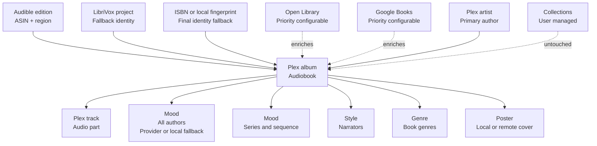

# VocalisMeta for Plex

A legacy Plex music metadata agent for audiobook libraries. It searches and
updates book metadata directly from Audible's regional catalog API, with an
optional LibriVox fallback for public-domain recordings; it does not require
the Audnexus service.

Development snapshot: **0.1.0**. This repository uses a fixed, manually defined
version and does not generate or change it during builds.

The repository keeps its deployable components separate:

- `VocalisMeta.bundle/` is the complete Plex metadata-agent runtime.
- `public-web/` is the lightweight PHP project website.

The official Git repositories are:

- Primary GitLab: `git@gitlab.kladhest.se:kladhest/vocalismeta.git`
- GitHub mirror: `git@github.com:kladhest-se/vocalismeta.git`

Both repositories contain the same official source and release files.

## What it adds

- Title and optional subtitle
- Authors and narrators
- Publisher, release date, summary, and Audible rating
- Audible genre hierarchy
- Series name and number in the album sort title
- Author and series Mood tags
- Parseable series-sequence, language, and edition Mood tags
- High-resolution cover artwork
- ASIN quick matching and per-item region overrides
- Embedded ASIN and Audible-region detection
- Embedded LibriVox project-ID detection
- Embedded ISBN and audiobook-edition hint detection
- Embedded series and sequence fallback when the matched source has no series
- Embedded author and narrator fallback when the matched source has none
- Runtime-, narrator-, language-, year-, and abridgment-aware edition matching
- Detailed Fix Match labels for distinguishing audiobook editions
- Configurable local-versus-Audible cover preference
- Embedded artwork from ID3, MP4/M4B, FLAC, Vorbis, and Opus tags
- Rate-limit-aware API retries with bounded exponential backoff
- Schema validation for malformed catalog products and nested metadata
- Ordered multi-region Audible search with Open Library and Google Books enrichment
- Optional LibriVox matching with path-aware source protection and distinct
  project identities
- Stable ISBN or evidence-fingerprint identities for locally matched books
- Configurable enrichment priority and per-refresh request budget
- Optional validated JSON configuration with safe reloads and secret-file support

The artist agent is intentionally conservative. Audible's catalog API exposes
author names and identifiers through products, but not full author biographies
or portrait images. It sets the author name, sort name, and representative book
genres without scraping Audible web pages.

## Install

### Debian and Ubuntu

These commands use Plex's standard Debian/Ubuntu plug-in directory. Confirm
that Git is available, clone the repository into a working directory, and copy
only `VocalisMeta.bundle` into Plex:

```bash
git --version

PLUGIN_DIR='/var/lib/plexmediaserver/Library/Application Support/Plex Media Server/Plug-ins'
CHECKOUT_DIR='/tmp/VocalisMeta'

sudo mkdir -p "$PLUGIN_DIR"
git clone git@gitlab.kladhest.se:kladhest/vocalismeta.git "$CHECKOUT_DIR"
git -C "$CHECKOUT_DIR" remote add github \
  git@github.com:kladhest-se/vocalismeta.git
sudo cp -a "$CHECKOUT_DIR/VocalisMeta.bundle" "$PLUGIN_DIR/VocalisMeta.bundle"
sudo chown -R plex:plex "$PLUGIN_DIR/VocalisMeta.bundle"
```

Restart Plex Media Server and verify that the service returned to its active
state:

```bash
sudo systemctl restart plexmediaserver
sudo systemctl --no-pager --full status plexmediaserver
```

Then configure the audiobook library in Plex Web:

1. Open **Settings → Manage → Libraries**.
2. Create a **Music** library for audiobooks, or edit the existing audiobook
   library.
3. Open the library's **Advanced** settings.
4. Select **Plex Music Scanner** (legacy, where shown) as the scanner and
   **VocalisMeta Agent** as the metadata agent.
5. Save the library and run **Refresh All Metadata**.

**Store track progress** is a Plex library/scanner preference rather than a
metadata-agent preference, so `DefaultPrefs.json` cannot select it. Enable it
in the audiobook library's Advanced settings when the option is available.

For a combined archive installation, extract `VocalisMeta.zip`, enter
`VocalisMeta/vocalismeta`, and copy its `VocalisMeta.bundle` directory into the
same `Plug-ins` path. Restart Plex afterward.

Plex's custom agent system is legacy functionality. If the agent is not listed,
first confirm that the server build and platform still load legacy agents, that
the directory is named exactly `VocalisMeta.bundle`, and that it does not
contain another nested `VocalisMeta.bundle` directory.

If you installed the earlier `AudibleDirect.bundle` development snapshot,
remove it before installing `VocalisMeta.bundle`. Plex treats VocalisMeta's new
`com.plexapp.agents.spokenmeta` identifier as a different agent, so select
**VocalisMeta Agent** for the library and refresh its metadata afterward. Do not
keep both bundle names installed at the same time.

If upgrading from `SpokenMeta.bundle`, move or remove the legacy bundle before
installing `VocalisMeta.bundle`. The internal provider identifier remains
`com.plexapp.agents.spokenmeta`, so existing album GUIDs and VocalisBook cloud
identities remain compatible. Never leave both bundle directories active
because they declare the same Plex provider.

Typical server data locations:

- Debian/Ubuntu: `/var/lib/plexmediaserver/Library/Application Support/Plex Media Server/Plug-ins`
- Other Linux installations: `$PLEX_HOME/Library/Application Support/Plex Media Server/Plug-ins`
- Windows: `%LOCALAPPDATA%\Plex Media Server\Plug-ins`
- macOS: `~/Library/Application Support/Plex Media Server/Plug-ins`

The Linux path can be customized through Plex's application-support directory.
See Plex's documentation for the
[server data directory](https://support.plex.tv/articles/202915258-where-is-the-plex-media-server-data-directory-located/)
and [manual plug-in installation](https://support.plex.tv/articles/201187656-how-do-i-manually-install-a-plugin/).

## Project website

The standalone site lives in `public-web/`. It is a responsive, dependency-free
PHP and CSS landing page: no database, JavaScript framework, package manager,
CDN, remote font, or external image service is required.

Run it locally from the repository root with PHP 7.4 or newer:

```bash
php -S 127.0.0.1:8080 -t public-web
```

For production, point a PHP virtual host's document root at `public-web/`.
The website is not installed into Plex and is not required by the metadata
agent.

## Configuration

Plex's agent Preferences UI remains the normal configuration method. The
`VocalisMeta.bundle/Contents/DefaultPrefs.json` file defines that UI and should
not be edited.
For repeatable Docker or multi-server deployments, VocalisMeta can optionally
read a JSON file outside the bundle.

Create a JSON file outside the bundle and enter its absolute path in `Optional
absolute path to VocalisMeta JSON configuration` in the agent preferences. If
that preference is blank, the process environment variable
`VOCALISMETA_CONFIG_FILE` may provide the absolute path instead. The UI path
takes priority over the environment variable. VocalisMeta only reads the file;
it never modifies it.

The legacy `SPOKENMETA_CONFIG_FILE`, `SPOKENMETA_PLUGIN_DIRECTORY`,
`SPOKENMETA_LOG_FILE`, and `SPOKENMETA_GITHUB_REPOSITORY` environment variables
remain accepted as lower-priority compatibility aliases.

Only keys present in the JSON override Plex preferences. A minimal file is:

```json
{
  "schema_version": 1,
  "audible": {
    "region": "uk",
    "fallback_regions": ["us", "de"]
  },
  "network": {
    "attempts": 3,
    "timeout_seconds": 45
  }
}
```

The example file represents the version-one sections and normal defaults.
Supported sections and constrained values are:

| Section | Keys |
| --- | --- |
| `audible` | `region`, `fallback_regions`, `maximum_results`, `exclude_preorders`, `include_adult`, `api_base_url` |
| `providers` | `librivox`, `open_library`, `google_books`, `enrichment_priority`, `request_budget` |
| `metadata` | `include_subtitle`, `simplify_title`, `keep_existing_genres`, `authors_as_moods`, `series_as_moods`, `embedded_series_fallback`, `embedded_contributor_fallback`, `author_genres` |
| `artwork` | `preference`, `requested_size` |
| `network` | `attempts` from 1–5 and `timeout_seconds` from 10–120 |
| `logging` | `level`: `DEBUG`, `INFO`, `WARN`, or `ERROR` |

Audible regions are `au`, `ca`, `de`, `es`, `fr`, `in`, `it`, `jp`, `us`, or
`uk`; at most four fallback regions may be listed. `maximum_results` accepts
10, 20, 25, or 50. Provider request budgets accept 2, 4, 6, 8, or 12. Artwork
sizes accept 500, 1000, 2000, or 3000, and artwork preference accepts
`local_first`, `audible_first`, `local_only`, or `audible_only`. The enrichment
priority is `openlibrary_first` or `googlebooks_first`.

The schema is strict. Unknown keys, incorrect JSON types, unsupported values,
relative configuration paths, oversized files, and unsafe custom API URLs
reject the entire new file. On the first invalid load, VocalisMeta uses Plex
preferences. If a previously valid file becomes invalid while being edited,
the agent keeps its last known good values and logs the error once for that
file revision. Correcting the file reloads it automatically; restarting Plex is
not required. Changing or clearing the configured path immediately removes
overrides from the previous path.

LibriVox has an enable switch plus a matching mode. Leaving the switch off is
the effective `disabled` mode. When enabled, the modes are:

| Mode | Unhinted audiobook search behavior |
| --- | --- |
| `hinted_only` | Use LibriVox only for an exact project ID or a media path containing the standalone word `librivox`. Recommended for mixed commercial/public-domain libraries. |
| `fallback` | Search Audible first, then LibriVox if Audible has no acceptable recording. This preserves the original enabled behavior. |
| `preferred` | Search LibriVox first, then Audible if LibriVox has no acceptable recording. |

An enabled, explicitly LibriVox-hinted media path is always protected from an
Audible cross-match, regardless of the selected mode. JSON deployments can set
the same behavior with `providers.librivox.enabled` and
`providers.librivox.mode`.

Do not store a Google Books key directly in JSON. Put the key alone in a UTF-8
text file and reference it as follows:

```json
{
  "schema_version": 1,
  "providers": {
    "google_books": {
      "enabled": true,
      "api_key_file": "/run/secrets/google_books_api_key"
    }
  }
}
```

A relative `api_key_file` is resolved relative to the JSON file. The secret is
limited to 16 KiB, trailing whitespace is removed, and embedded newlines or NUL
bytes are rejected. Secret changes reload automatically, and secret contents
are never written to the agent log. Restrict file permissions so only the Plex
service account can read it.

Configuration and item metadata use this precedence, from highest to lowest:

1. An explicit Fix Match query or filename/folder identity hint
2. Embedded per-book identity, edition hints, and enabled metadata fallbacks
3. Keys present in the optional JSON file
4. Plex agent preferences
5. Built-in defaults

## Recommended files and tags

Use one folder per author and book, with `album` and `albumartist` embedded tags:

```text
Audiobooks/
  Andy Weir/
    Project Hail Mary/
      Project Hail Mary.m4b
```

For multi-file books, set the same album and album artist on every part and use
correct track/disc numbers.

## Quick match

Put an Audible ASIN anywhere in the album title, filename, or manual Fix Match
query. Add a region in square brackets when it differs from the library default:

```text
B08G9PRS1K
B08G9PRS1K [us]
Book Title B01234ABCD [uk].m4b
```

Supported regions: `au`, `ca`, `de`, `es`, `fr`, `in`, `it`, `jp`, `us`, `uk`.

When LibriVox matching is enabled, a manual Fix Match query or filename can
target an exact project with `librivox:52` or `LV #52`. VocalisMeta stores that
identity as `librivox:52`, keeping it separate from Audible region/ASIN
identities. An exact project ID may also be embedded as `LIBRIVOX_ID`,
`LIBRIVOX_BOOK_ID`, or `LIBRIVOX_PROJECT_ID`.

The word `librivox` in any media path is also a source hint. With LibriVox
matching enabled, VocalisMeta searches LibriVox before Audible for that book. If
the API does not return an acceptable LibriVox project, the agent offers its
stable Local metadata identity instead of silently attaching a commercial
Audible edition. An explicit or embedded ASIN remains stronger than this generic
path hint. This behavior supports common download folders such as
`peter_pan_0707_librivox_64kb_mp3` without manufacturing a project ID.

### Multiple metadata sources

`Fallback Audible regions` accepts up to four comma-separated region codes.
The selected or embedded region is always searched first. Exact ASIN lookup
tries each configured store in order; title searches merge regional results and
deduplicate identical ASINs, preferring the earliest configured store.
Title matching first tries the complete album title and author. If that is not
good enough, VocalisMeta also tries both sides of ` - `, the main title before a
colon, and a clean title derived from the media filename. Candidates are scored
against the best title variant. A final title-only retry handles Audible searches
that reject combined or differently formatted author names. Title-only results
must still match at least one supplied author, preventing an exact title from
silently selecting a different writer. If Plex omits the artist from a manual
Fix Match request, embedded author tags are used when available.
When an album already belongs to a VocalisMeta-matched author, that parent author
takes precedence over the track-level Artist tag. This prevents a narrator stored
as Artist from replacing the known book author during later searches or refreshes.
VocalisMeta recognizes the parent GUID field names used by different Plex builds.
If no matched parent is available, an embedded book-author tag is preferred; as a
final safeguard, a path whose book folder matches the title may supply the author
from the documented `Author/Book/file` layout. Generic library folders are ignored.
Compound artist names that Audible does not expose as one contributor receive a
stable name-backed VocalisMeta identity, preventing their Plex parent from remaining
`local://` while preserving the complete displayed author credit.
Selecting a new match replaces stale title, sort title, publisher, description,
date, genre, narrator, author, and series values owned by the previous provider
record even when Plex invokes the update without its force flag. Plex field locks
remain authoritative, while Open Library and Google Books remain missing-field-only.
Manual album searches recover the author from both name-backed and Audible-ASIN
VocalisMeta parent GUIDs when Plex omits the Artist field. Audible title-search
responses use a short cache so a transient empty result does not suppress matches
for the rest of the day; exact ASIN lookups retain the longer cache. LibriVox
title searches likewise use a five-minute cache, while exact project lookups
retain the one-week cache. A malformed cached LibriVox response is retried once
without the HTTP cache.

LibriVox matching is disabled by default. Enable it in the VocalisMeta agent
settings for public-domain recordings and select `hinted_only`, `fallback`, or
`preferred` as described in Configuration. A media path containing the
standalone word `librivox` always searches LibriVox first and prevents an
Audible cross-match when no acceptable LibriVox project exists. A LibriVox
match maps project authors to
Mood and readers to Style, imports its description, genres, copyright year, and
cover, and uses language and duration as matching evidence.
It does not invent an Audible ASIN, series, publisher, rating, or Plex
collection. Open Library and Google Books may still fill fields missing from
the selected LibriVox project under the same priority and request-budget rules
below. The integration uses LibriVox's documented
[audiobook API](https://librivox.org/api/info).

Open Library enrichment is enabled by default and requires no API key. It is
never used as a search provider or shown as a remote edition in Fix Match.
When Audible and LibriVox do not produce an acceptable recording, VocalisMeta
offers a local match with an embedded ISBN identity when available, otherwise a
deterministic local fingerprint. Open Library is queried only while refreshing
an identity-backed album and only when a supported field is still empty.

Google Books is an optional enrichment source. Enable it and enter a Google
Books API key in the agent preferences; leaving the key blank disables all
Google Books requests. It fills descriptions, publication dates, genres, ISBN
relationships, or cover candidates that remain missing. It is never used for
remote-edition matching or shown as a remote edition in Fix Match. See Google's
[Books API key instructions](https://developers.google.com/books/docs/v1/using#APIKey).

`Book enrichment source priority` selects either Open Library or Google Books
first. Open Library first is the default and preserves the original behavior.
The first provider fills every supported gap it can; the second provider may
fill only fields that still remain empty. Audible and existing Plex metadata
remain authoritative regardless of this setting.

`Maximum enrichment API calls per album refresh` bounds logical JSON requests
across both book providers. The default is eight. ISBN-10/ISBN-13 alternatives,
title fallback, and an Open Library Work description each consume one call.
Retries of the same request and artwork downloads do not consume additional
budget. When the budget is exhausted, the agent keeps everything already found
and continues the refresh without additional enrichment calls.

The matched audiobook source remains authoritative for audiobook-specific
information. For Audible this includes narrators, edition identity, series,
ratings, and release metadata; for LibriVox it includes readers and project
identity. The ordered book providers may fill a missing description,
publication date, genre list, ISBN relationship, or remote cover. Neither can
replace existing Plex or earlier-provider values, and neither supplies authors,
narrators, series, publisher, ratings, collections, or matching IDs. Their
responses use the same bounded retry handling and are cached for one week.
Google API keys are redacted from request-failure URLs written to the agent log.

Audible series data also remains authoritative. If the matched Audible edition
has no series, or the match is from LibriVox, VocalisMeta may use an embedded
series name and sequence. This fallback adds the same `Series: Name` Mood and
stable album sort key as provider series data; it never creates or modifies a
Plex collection. Disable `Use embedded series when the matched source has no
series` if content-group or movement tags in your files mean something else.

Provider authors, narrators, and LibriVox readers remain authoritative too. If
those lists are absent, VocalisMeta can use embedded album-author/author values
as exact author Moods and embedded narrator/reader values as exact Styles.
Disable `Use embedded authors or narrators when the matched source has none` to
turn this off. This fallback does not change the Plex primary artist link,
which still comes from the scanner and the book's `albumartist` tag.

When Audible or an audio file exposes an ISBN, the agent validates its ISBN-10
or ISBN-13 checksum. Each enrichment source tries an exact edition query before
falling back to a title-and-author query. Embedded ISBNs take precedence because
they describe the local file. If no recording provider matches, a valid embedded
ISBN also becomes the stable `isbn:` album identity. The agent still does not
put the ISBN in Mood, Genre, Style, Collection, title, or another visible field.

For ISBNs with a standard equivalent, the agent tries both forms. A valid
ISBN-10 is converted to ISBN-13, and an ISBN-13 beginning with `978` is converted
to ISBN-10. ISBN-13 values beginning with `979` remain ISBN-13 because they have
no ISBN-10 equivalent.

If Plex has no summary after the Audible update, the agent follows the matched
Open Library Work key and uses its complete description, including paragraph
breaks. The shorter search-result `first_sentence` is used only when that Work
has no description. Existing Plex or Audible summaries are never replaced.

### Metadata mapping for player apps

The library uses Plex's music hierarchy: artist is the primary author, album is
the audiobook, and track is an audio file or part. Accurate `albumartist` tags
therefore give a player a fast primary-author index. List the library's artist
items, find (for example) `Terry Pratchett`, then fetch that artist item's
`children` key to get its albums.



Album metadata preserves relationships that Plex has no dedicated audiobook
field for. Audible narrators and LibriVox readers use the same Style mapping:

- Mood `Terry Pratchett`: an author; all Audible authors are retained
- Mood `Series: Discworld`: a series membership
- Mood `Sequence: Discworld #5`: the parseable position in that series
- Mood `Language: English`: the recording language when known
- Mood `Edition: Unabridged`: the recording edition when known
- Style `Stephen Briggs`: a narrator
- Genre `Fantasy`: a book genre
- `title_sort`: normalized order for the primary provider or fallback series

A player can use an album's `parentRatingKey`/`parentTitle` for the primary
author and its Mood tags for co-authors. To find all books involving an author,
combine the artist's albums with albums whose Mood exactly equals that author
name. Namespace Moods beginning with `Series: `, `Sequence: `, `Language: `,
or `Edition: ` are relationships or recording attributes, not author names.
The agent does not write collections, so user-created collections remain
untouched.

Every unique Audible series is retained as its own exact Mood value. Duplicate
series names that differ only in spacing or letter case are collapsed. A
separate `Sequence: Name #position` Mood preserves exact `Series: Name`
matching while allowing a player to display and order the position. Because
Plex provides only one album sort title, the first Audible series remains the
primary sort series. Common sequence forms such as `2`, `02`, `Book 2`, `2.5`,
and `Book IV` are normalized for the sequence Mood and stable lexical sort key.
Embedded fallback supplies at most one series and never replaces a valid
Audible series list.

### Client Identity Contract v1

Player applications should use the album's VocalisMeta GUID as the durable book
identity and use `ratingKey` only as a server-local fallback. VocalisMeta keeps
existing Audible and LibriVox IDs unchanged and adds two local fallback forms:

The VocalisMeta rename does not change this wire contract. The historical Plex
provider `com.plexapp.agents.spokenmeta` and canonical `spokenmeta:` client-key
prefix intentionally remain stable so VocalisBook can reuse progress,
bookmarks, and history created before the rename.

| GUID identifier | Meaning | Canonical client key |
| --- | --- | --- |
| `B08G9PRS1K_us` | Audible ASIN and marketplace | `spokenmeta:audible:us:B08G9PRS1K` |
| `librivox:52` | LibriVox project | `spokenmeta:librivox:52` |
| `isbn:9780593135204` | Valid embedded ISBN edition | `spokenmeta:isbn:9780593135204` |
| `local:0123456789abcdef` | Deterministic local evidence fingerprint | `spokenmeta:local:0123456789abcdef` |

A complete Plex GUID normally looks like
`com.plexapp.agents.spokenmeta://B08G9PRS1K_us?lang=en`. Clients must verify the
`com.plexapp.agents.spokenmeta` scheme, remove the query and an optional Plex
`/-1` suffix, URL-decode the remaining identifier, and then parse one of the
forms above. Name-backed IDs such as `name:Kevin+J.+Anderson_us` are **artist
identities**, not audiobook identities, and must never key listening progress.

Audible, LibriVox, and ISBN keys are strong cross-server identities. A `local:`
key is intentionally a lower-confidence fallback derived from normalized title,
author, runtime rounded to five minutes, language, and abridgment evidence. It
is stable across Plex server rebuilds when that evidence remains the same, but
may change when tags or edition evidence are corrected. If no recognized book
GUID is available, use `plex:{machineIdentifier}:{ratingKey}`; a raw rating key
alone is unsafe because it is only unique inside one Plex server.

The complete client handoff, parsing rules, migration strategy, request model,
and test vectors are in [CLIENT_INTEGRATION.md](CLIENT_INTEGRATION.md).

Typical authenticated Plex requests are:

```text
GET /library/sections/{sectionKey}/all?type=8
GET /library/metadata/{artistRatingKey}/children
GET /library/metadata/{albumRatingKey}
```

Follow the `key` values returned by the server rather than constructing item
paths from titles. Include the server's normal `X-Plex-Token` authentication.

### Embedded identity and edition tags

The agent scans media parts in order and can combine identity tags found in
different files, so the ASIN does not need to appear in the folder or filename.
Supported containers:

- MP3 ID3v2 (`TXXX`/`WXXX` and common text fields)
- M4A/M4B/MP4 freeform iTunes metadata
- FLAC Vorbis comments
- OGG Vorbis and Opus comments
- APEv2 tags, including APE-tagged MP3, FLAC, and WavPack files

Recognized ASIN names include `ASIN`, `AUDIBLE_ASIN`, `AMAZON_ASIN`, and
`AUDIBLE_PRODUCT_ID`. Region may be stored as `AUDIBLE_REGION`,
`AUDIBLE_MARKETPLACE`, `REGION`, or inferred from an Audible URL such as the
common `WWWAUDIOFILE` tag. Valid ISBNs are read from `ISBN`, `ISBN10`, `ISBN13`,
or `BOOKISBN`. Common `NARRATOR`, `READ_BY`, `LANGUAGE`, and `ABRIDGED` tags are
also used as edition-matching hints. LibriVox project IDs are read from
`LIBRIVOX_ID`, `LIBRIVOX_BOOK_ID`, or `LIBRIVOX_PROJECT_ID`; explicit
`librivox:52`/`LV #52` text and documented LibriVox API URLs containing `id=52`
are recognized too.

Series fallback recognizes `SERIES`, `SERIES_TITLE`, `BOOK_SERIES`, ID3
content-group fields such as `TIT1`, and MP4 movement/grouping equivalents.
Sequence aliases include `SERIES_PART`, `SERIES_NUMBER`, `BOOK_NUMBER`, and
movement-number fields. The first valid series name and sequence found across
the book's media parts are combined.

Contributor fallback recognizes `AUTHOR`, `BOOK_AUTHOR`, `ALBUMARTIST`, ID3
`TPE2`, and MP4 `aART` for authors. Narrator aliases include `NARRATOR`,
`NARRATED_BY`, `READ_BY`, `READER`, ID3 `TPE3`, and the audiobook convention
of storing narrators in `COMPOSER`/`TCOM`. Semicolon, pipe, newline, and native
multi-value separators are deduplicated while preserving their original order.

Source-identity precedence is deterministic:

1. A LibriVox ID explicitly supplied in Fix Match, a folder, or a filename
2. An ASIN explicitly supplied there, followed by an embedded ASIN
3. An embedded LibriVox project ID
4. An acceptable LibriVox match for a LibriVox-hinted media path; otherwise a
   stable local identity without an Audible cross-match
5. An acceptable Audible title/author/edition match
6. An acceptable enabled LibriVox fallback match
7. A valid embedded ISBN, otherwise a deterministic local fingerprint

An embedded ASIN therefore wins if a file also contains an old LibriVox tag.
Audible-region selection independently uses an explicit `[region]` first, then
the embedded region, and finally the agent's configured default region.

Every quick-match ASIN is verified using an exact `asins=` request before Plex
receives a score-100 result. If an automatic scan encounters a stale embedded
or filename ASIN, the agent removes the identity hints and falls back to normal
title/author matching. An ASIN-only manual Fix Match returns no result when the
selected Audible region does not contain that ASIN. Metadata refreshes with an
invalid or missing ASIN preserve the existing Plex metadata.

LibriVox project IDs are also verified before a score-100 result. A stale ID in
an automatic scan falls back to normal title matching, while an exact manual
`librivox:` Fix Match never silently cross-matches to Audible. Embedded
LibriVox IDs are ignored when LibriVox matching is disabled.

The final ISBN/local result is deliberately labeled `Local metadata` in Fix
Match. It prevents a catalog miss from selecting an unrelated recording and
gives player apps a durable identity without inventing an Audible or LibriVox
record. Refreshing it preserves scanner and embedded values while Open Library
or Google Books may fill only supported missing fields.

Example FFmpeg commands for an M4B file:

```bash
ffmpeg -i input.m4b -c copy \
  -movflags use_metadata_tags \
  -metadata ASIN=B08G9PRS1K \
  -metadata AUDIBLE_REGION=us output.m4b
```

To store an ISBN and optional edition hints:

```bash
ffmpeg -i input.m4b -c copy \
  -movflags use_metadata_tags \
  -metadata ISBN=9780593135204 \
  -metadata NARRATOR="Ray Porter" \
  -metadata LANGUAGE=eng \
  -metadata ABRIDGED=false output.m4b
```

To store an exact LibriVox project identity:

```bash
ffmpeg -i input.m4b -c copy \
  -movflags use_metadata_tags \
  -metadata LIBRIVOX_ID=52 output.m4b
```

To store series fallback metadata:

```bash
ffmpeg -i input.m4b -c copy \
  -movflags use_metadata_tags \
  -metadata SERIES="Discworld" \
  -metadata SERIES-PART="Book 5" output.m4b
```

To store contributor fallback metadata:

```bash
ffmpeg -i input.m4b -c copy \
  -movflags use_metadata_tags \
  -metadata ALBUMARTIST="Terry Pratchett" \
  -metadata NARRATOR="Stephen Briggs" output.m4b
```

### Chapters and track titles

VocalisMeta deliberately does not rename Plex tracks or manufacture chapters.
For multi-file books, Plex obtains each part's displayed name from the local
track `TITLE` tag, so chapter or part names should be embedded before scanning.
For a single chapterized M4B, VocalisMeta leaves the internal chapter table
unchanged; whether those markers are exposed is determined by Plex and the
player. Writing track titles through the server would require a Plex token and
an extra self-API update with unreliable file-to-chapter alignment.

### Edition matching

Title and author remain the main match signals. When available, the agent also
compares Plex's summed media-part duration with Audible's runtime, the embedded
narrator and language, Plex's year, and abridged/unabridged tags. Missing data
is neutral. Meaningful conflicts lower only the conflicting edition, which
helps separate releases that otherwise share the same title and author.
When Plex's legacy search object omits part durations, VocalisMeta recovers the
album total from Plex's local metadata tree. A severe runtime conflict cannot
auto-match merely because a collection begins with the requested short title.

Fix Match results show the title, authors, narrators, duration, release year,
abridged or unabridged format, language, and Audible region when each value is
available. Exact ASIN results use the same label, making regional or otherwise
similar editions easier to distinguish before applying metadata.

### Local album covers

`Album artwork preference` offers four policies. The existing `audible` names
mean matched-source remote artwork: Audible or LibriVox first, with
book-provider artwork used in the configured enrichment order only if the item
has no matched-source, local, or existing cover:

- `local_first` (default): use local artwork first and keep Audible as fallback
- `audible_first`: use Audible first and keep local artwork as fallback
- `local_only`: never download an Audible cover
- `audible_only`: ignore local artwork and retain only the Audible cover

Local artwork is detected beside any audio part. Supported names are
`cover`, `folder`, `front`, or the exact audio filename, with `.jpg`, `.jpeg`,
`.png`, or `.webp` extensions. Matching is case-insensitive. Images larger than
32 MiB or files without a valid image signature are ignored.

If no sidecar cover is found, the agent reads embedded ID3 `APIC`, MP4/M4B
`covr`, native FLAC picture blocks, and Vorbis/Opus
`METADATA_BLOCK_PICTURE`. A front-cover image is preferred when the format
provides picture types. Embedded data is bounded to 32 MiB and must have a
valid JPEG, PNG, or WebP signature.

For multi-file books, the agent checks up to 256 unique media parts in Plex
order and combines Audible or LibriVox identity, region, ISBN, authors,
narrators, series, language, and abridgment hints across them. It uses the first
valid embedded cover if no sidecar image exists.

Remote artwork downloads use the configured request timeout and retry count.
The response must contain a supported image. Audible failures fall through
progressively smaller generated sizes and then Audible's published URLs. When
the matched Audible or LibriVox record has no usable image, Open Library and
Google Books candidates follow the configured enrichment priority.

After a successful artwork refresh, Plex retains only the current poster keys
for every policy, including mixed local/Audible policies. This removes obsolete
covers left behind by earlier matches without clearing artwork when every new
source fails.

### API retry behavior

The agent retries only failures that are normally temporary: connection and
timeout errors, HTTP 408/425/429, and HTTP 500/502/503/504. It honors the
server's `Retry-After` header up to 30 seconds; otherwise delays increase from
1 to 2 to 4 seconds. Other HTTP 4xx responses fail immediately. The maximum
attempt count and per-request timeout are configurable in the agent settings.

Catalog responses are validated before matching. Entries without a valid ASIN
and textual title are discarded. Malformed contributor, category, series,
rating, genre, or artwork structures are treated as missing optional metadata
instead of aborting the scan. Remote artwork values must use HTTP or HTTPS and
still pass the separate response-image validation before Plex stores them.

A valid catalog response containing zero books is different from a failed
request. The former may produce the stable local fallback identity described
above. A timeout, connection/HTTP failure, invalid JSON, or malformed top-level
catalog response instead defers automatic matching and returns no local match,
allowing Plex to retry without persisting a misleading fallback identity. If
some regional requests succeed and others fail, matching may still accept a
valid remote result; otherwise the search is deferred as a partial provider
failure.

## Why this differs from Audnexus.bundle

Audnexus.bundle already uses Audible for title search, then relies on Audnexus
for metadata updates and author details. This agent uses the same regional and
ASIN ideas but also performs updates directly against Audible. It additionally:

- tolerates products with missing optional response keys;
- uses `asins=` for exact lookup rather than treating an ASIN as a keyword;
- reads ASIN and marketplace information from common embedded tag formats;
- applies a deterministic local/Audible artwork policy without relying on agent order;
- retries a title without its subtitle and deduplicates results;
- parses Audible's current rating, series, category, and image structures;
- keeps the region in Plex's metadata ID so later refreshes use the same store;
- allows an optional custom Audible-compatible base URL.

## Troubleshooting

The log is normally named `com.plexapp.agents.spokenmeta.log` under the Plex
Media Server logs directory. Set the agent logging preference to `DEBUG`, retry
Fix Match, and inspect that log.

- **No agent in the list:** check the exact bundle nesting and restart Plex.
- **No automatic match:** verify `album` and `albumartist`, then try the ASIN.
- **Wrong regional edition:** use `[uk]`, `[de]`, etc. with the ASIN.
- **Metadata but no cover:** make sure Plex can reach `m.media-amazon.com`,
  `librivox.org`, `covers.openlibrary.org`, and `books.google.com` as applicable.
- **No results:** test a manual Fix Match with the main title only. Audible's
  catalog is regional, so also check the selected region. Enable LibriVox for
  public-domain recordings and LibriVox-named source paths.

With `INFO` or `DEBUG` logging, an unsuccessful search now states whether
Audible returned no catalog candidates or only candidates below the automatic
match threshold. Rejected candidate titles, regions, and scores are included
when available.

Every album search also ends with one grep-friendly `SEARCH_SUMMARY` record.
It reports the outcome, provider, stable identity, score, resolved author and
where that author came from, accepted candidates, raw Audible catalog hits,
Audible query count, provider-failure count, manual-search state, and a stable
reason code. For example:

```text
SEARCH_SUMMARY outcome="results" provider="audible" identity="B08G9PRS1K_us" score="100" title="Project Hail Mary" author="Andy Weir" author_source="embedded" candidates="1" catalog_hits="1" audible_queries="1" provider_failures="0" manual="false" reason="exact_asin"
```

To follow only these final decisions while matching or refreshing:

```bash
tail -F \
  '/var/lib/plexmediaserver/Library/Application Support/Plex Media Server/Logs/PMS Plugin Logs/com.plexapp.agents.spokenmeta.log' |
  grep --line-buffered 'SEARCH_SUMMARY'
```

Reason codes distinguish exact IDs, ranked Audible matches, preferred or
fallback LibriVox matches, empty Audible responses, rejected catalog products,
below-threshold candidates, local fallback, disabled LibriVox, and missing
titles. Provider problems use `outcome="deferred"` with
`provider_unavailable`, `invalid_provider_response`, or
`partial_provider_failure`; `provider_failures` reports how many logical
catalog requests failed. Quoted values escape quotes, backslashes, and line
breaks so one search always occupies one physical log line.

## License

MIT. This is an independent implementation informed by the documented behavior
and public repository structure of Audnexus.bundle; no Audnexus source code is
included.
